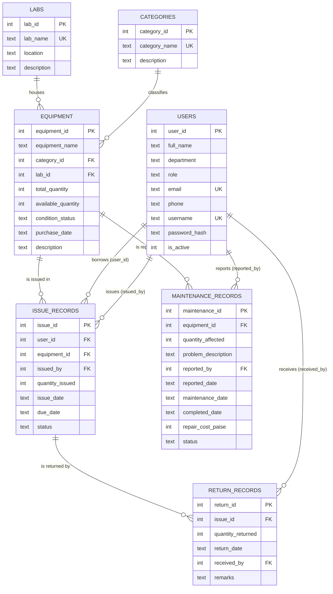

# ER Diagram and Relational Schema



## Text version (draw this in the viva)
```
 Labs 1───N Equipment N───1 Categories
              │1                 
      ┌───────┴────────┐
      N                N
 Issue_Records   Maintenance_Records
      │1
      N
 Return_Records
 Users 1───N Issue_Records (borrower)   Users 1───N Issue_Records (issued_by)
 Users 1───N Return_Records (received_by)   Users 1───N Maintenance_Records (reported_by)
```

## Relational schema (PK underlined with *, FK → target)
* **Labs**(*lab_id*, lab_name UNIQUE, location, description)
* **Categories**(*category_id*, category_name UNIQUE, description)
* **Users**(*user_id*, full_name, department, role ∈ {Admin, LabAssistant, Student, Faculty}, email UNIQUE, phone, username UNIQUE, password_hash, is_active, created_at)
* **Equipment**(*equipment_id*, equipment_name, category_id → Categories, lab_id → Labs, total_quantity ≥ 0, available_quantity with 0 ≤ available ≤ total, condition_status ∈ {Good, Fair, Poor}, purchase_date, description)
* **Issue_Records**(*issue_id*, user_id → Users, equipment_id → Equipment, issued_by → Users, quantity_issued > 0, issue_date, due_date ≥ issue_date, status ∈ {Issued, Partially Returned, Returned})
* **Return_Records**(*return_id*, issue_id → Issue_Records, quantity_returned > 0, return_date, received_by → Users, remarks)
* **Maintenance_Records**(*maintenance_id*, equipment_id → Equipment, quantity_affected > 0, problem_description, reported_by → Users, reported_date, maintenance_date, completed_date, repair_cost_paise ≥ 0, status ∈ {Reported, In Progress, Completed, Written Off})
* **View Issue_Outstanding** = Issue_Records + computed `outstanding = quantity_issued − SUM(returns)`.

All relationships are one-to-many. There are no many-to-many relationships; Issue_Records is already the "borrowing event" table between Users and Equipment.
